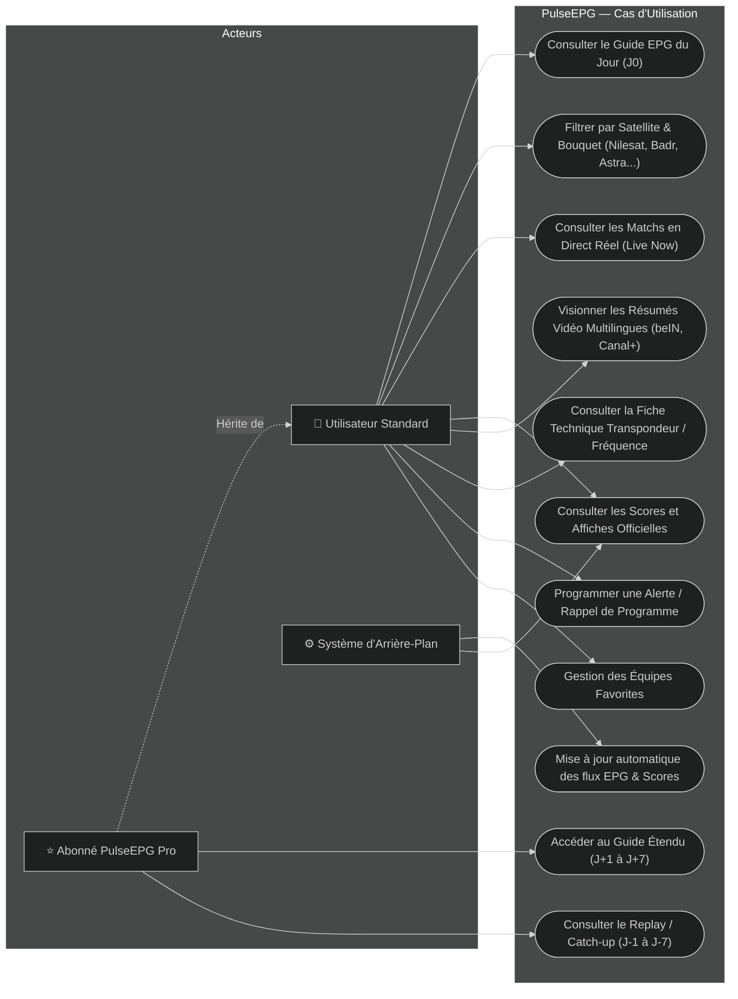
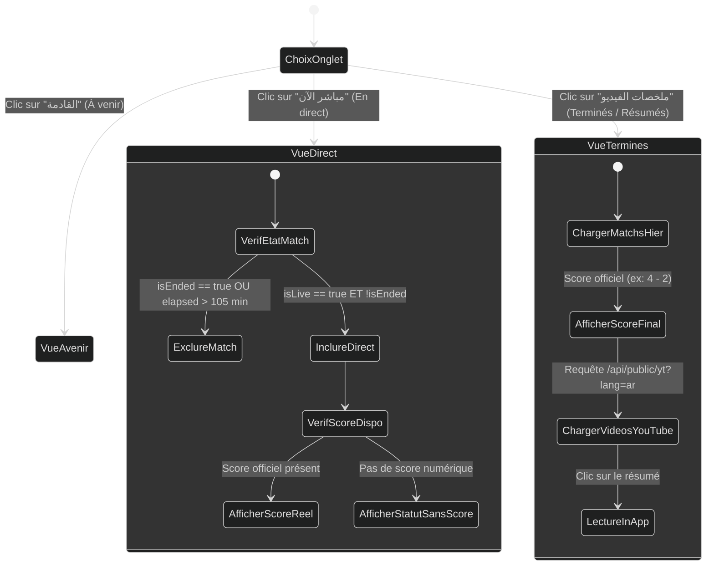

# PulseEPG — Spécifications Fonctionnelles Détaillées (Cahier des Charges)

**Projet** : PulseEPG (دليلك الشامل للقنوات)  
**Version** : 2.4.0  
**Statut** : Validé / En Production  
**Cible** : Web (PWA), Android (Capacitor)  

---

## 1. Contexte & Objectifs Stratégiques

### 1.1 Contexte Métier
Dans la région MENA (Moyen-Orient et Afrique du Nord) ainsi qu'au sein de la diaspora en Europe, les téléspectateurs s'appuient historiquement sur des installations de réception satellite multi-têtes (Nilesat 7°W, Badr 26°E, Astra 19.2°E, Hotbird 13°E).  
L'expérience utilisateur sur les décodeurs traditionnels est souvent dégradée :
- EPG satellite incomplet, tronqué ou lent à charger.
- Absence d'indication de la position orbitale et de la fréquence de réglage.
- Impossibilité de savoir instantanément quel diffuseur satellite retransmet une affiche de Ligue des Champions ou de championnat national.
- Confusion fréquente entre rediffusions télévisées et véritables retransmissions en direct.

### 1.2 Objectifs du Système PulseEPG
1. **Fournir un guide des programmes interactif, fluide et accessible hors-ligne** pour plus de 2 500 chaînes réparties sur les 4 satellites majeurs.
2. **Offrir un centre de contrôle sportif temps réel** certifiant les matchs réellement en direct, éliminant les faux directs et affichant le score instantané officiel.
3. **Assurer une expérience multilingue sans friction** (Arabe avec gestion RTL native irréprochable, Français, Anglais, Espagnol).
4. **Intégrer les résumés vidéo officiels** directement dans l'application avec sélection de la langue de commentaire (notamment beIN Sports arabe).
5. **Proposer un annuaire satellite interactif** répertoriant fréquences, polarisations, symbol rates et transpondeurs.

---

## 2. Profils Utilisateurs (Personas)

| Persona | Profil | Besoins Principaux | Fréquence d'Usage |
| :--- | :--- | :--- | :--- |
| **Tarik (Fan de Football)** | 34 ans, Casablanca. Équipé d'une parabole orientée Nilesat + Badr. | Connaître immédiatement les affiches de la soirée, les chaînes diffusantes (Arryadia TNT, beIN Sports), les scores en direct et voir les résumés avec commentaires arabes. | Quotidienne (soirées et weekends) |
| **Youssef (Technicien / Passionné Satellite)** | 42 ans, Alger. Récepteur Enigma2 / Android TV multi-satellites. | Recherche des fréquences précises, transpondeurs FTA (en clair), bouquets européens (Astra/Hotbird) et planification à J+7. | Hebdomadaire |
| **Sarah (Téléspectatrice Famille)** | 29 ans, Paris. Regarde les séries et films sur chaînes arabes et françaises. | EPG clair du jour, recherche de titres de films, affiches TMDB illustrées et rappels de début d'émission. | Quotidienne |

---

## 3. Diagramme des Cas d'Utilisation UML (Use Case Diagram)

---

## 4. Matrice des Exigences Fonctionnelles (Méthode MoSCoW)

### 4.1 Exigences Indispensables (Must Have)
- **REQ-F01 (Guide TV Central)** : Affichage chronologique des grilles EPG de 00:00 à 23:59 pour les chaînes sélectionnées.
- **REQ-F02 (Détection Direct Sportif Certifié)** : 
  - Seuls les matchs officiellement en cours (`isLive: true` et `!isEnded`) doivent figurer sous l'onglet "En direct".
  - Les matchs terminés (même diffusés en rediffusion sur la chaîne) doivent impérativement être exclus du direct.
  - La durée écoulée depuis le coup d'envoi ne peut excéder 105 minutes (90' de jeu + 15' de pause) pour un match EPG non relié à une API de score.
- **REQ-F03 (Exactitude des Scores)** : 
  - Aucun faux score par défaut (`0`, `0 : 0`, `0`) ne doit être injecté.
  - Si le score officiel n'est pas encore ouvert ou disponible, afficher le statut "En direct" ou le séparateur "VS".
- **REQ-F04 (Support Arabe & RTL)** : 
  - Interface adaptée de droite à gauche (RTL) sans marges vides à gauche ni décalages d'icônes.
  - Traduction des compétitions, états de match (`مباشر`, `نهاية المباراة`, `استراحة`).
- **REQ-F05 (Fiches Fréquences)** : Affichage modal des paramètres techniques (Fréquence, Pol, SR, FEC, Modulation, FTA/Crypté).

### 4.2 Exigences Importantes (Should Have)
- **REQ-F06 (Résumés Vidéo In-App)** : Lecteur YouTube intégré sans lien externe avec sélecteur de langue des commentateurs (Arabe, Français, Anglais, Espagnol).
- **REQ-F07 (Rappels & Notifications)** : Alertes sonores et notifications locales 5 minutes avant le début d'un match ou d'un programme.
- **REQ-F08 (Équipes Favorites)** : Marquage d'équipes en favoris avec filtrage dédié en 1 clic.

### 4.3 Exigences Confort (Could Have)
- **REQ-F09 (Guide Étendu J+1 à J+7)** : Réservé aux abonnés Pro avec vérification par jeton d'authentification.
- **REQ-F10 (Enrichissement TMDB)** : Récupération des jaquettes HD et des résumés officiels des films et séries.

---

## 5. Diagramme d'Activité UML — Parcours de Consultation d'un Match

---

## 6. Règles de Gestion Métier (Business Rules)

| Règle | Nom | Description |
| :--- | :--- | :--- |
| **BR-01** | **Antériorité du Match** | Si un match a été joué à $T_0$ et déclaré terminé (`FT`), toute rediffusion à $T_0 + \Delta$ sur une chaîne sportive est catégorisée comme **Rediffusion** et bannie de l'onglet Live. |
| **BR-02** | **Plafond Temporel Réglementaire** | La durée d'un match de football est fixée à 105 minutes (90' + 15'). Tout programme EPG sans télémétrie dépassant 105 min est réputé terminé. |
| **BR-03** | **Authentification Pro Sécurisée** | Tout accès aux dates `dayOffset > 0` ou `dayOffset < 0` exige un en-tête `Authorization: Bearer <token>` vérifié auprès de Supabase / Firestore (`is_pro == true`). |
| **BR-04** | **Neutralité des Zéros** | Une rencontre programmée dans le futur ne doit jamais exposer un score de `0 - 0` ; les propriétés de score doivent être `undefined`. |
