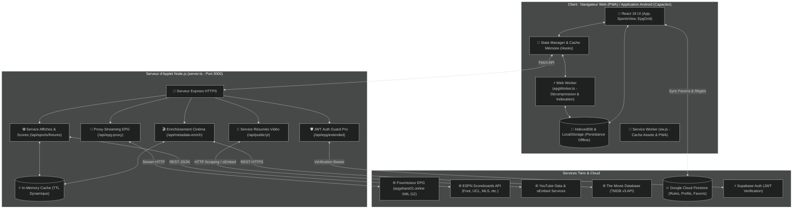
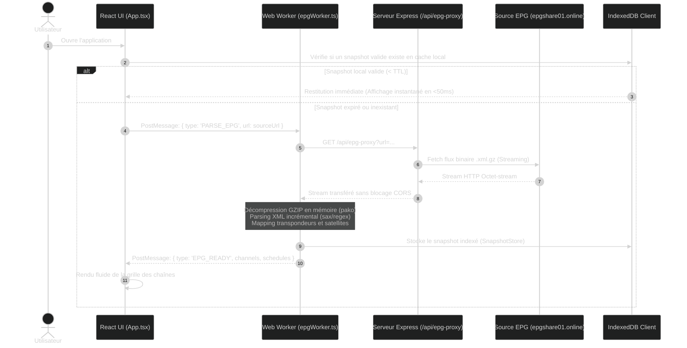
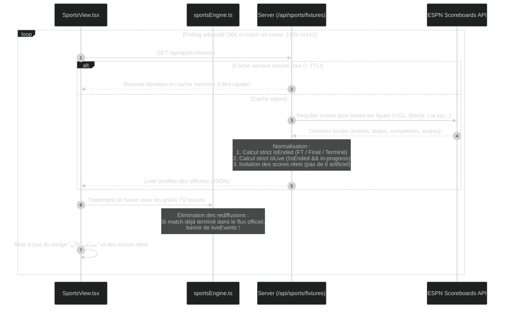
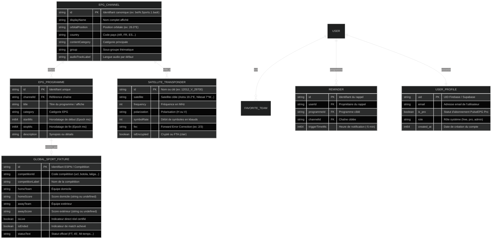

# PulseEPG — Dossier d'Architecture Technique & Spécifications Système (DAT)

**Projet** : PulseEPG (دليلك الشامل للقنوات)  
**Version** : 2.4.0  
**Statut** : Architecture Validée  
**Environnement** : Node.js Express + React 19 SPA + Web Workers + Firebase/Supabase  

---

## 1. Vue d'Ensemble de l'Architecture (Diagramme de Composants & Déploiement)

Le système PulseEPG adopte une architecture découplée assurant une latence minimale, une tolérance totale aux pannes réseau et une fluidité à 60 FPS sur mobile.

---

## 2. Diagrammes de Séquence UML

### 2.1 Flux de Chargement et Décompression EPG (Optimisation Web Worker)
Le fichier XMLTV compressé en GZIP fait plusieurs dizaines de mégaoctets. Pour ne jamais bloquer le thread principal de rendu de React, la décompression et l'indexation sont déportées dans un Web Worker.

### 2.2 Flux de Synchronisation des Matchs et Scores en Direct
Garantit que les scores sont mis à jour toutes les 30 secondes en direct, et que tout match terminé est basculé hors du direct.

---

## 3. Schéma Entité-Relation des Données (ERD)

---

## 4. Stratégie de Performance & Sécurité

### 4.1 Politique de Mise en Cache HTTP & Mémoire
- **Assets PWA (`/`, `/index.html`, `/assets/*`)** : Gérés par le Service Worker (`public/sw.js`) avec stratégie *Stale-While-Revalidate* pour démarrage instantané hors-ligne.
- **Flux EPG (`/api/epg-proxy`)** : En-tête `Cache-Control: public, max-age=1800` (30 minutes) pour éviter de saturer la source distante.
- **Résumés Vidéo (`/api/public/yt`)** : En-tête `Cache-Control: public, max-age=3600` (1 heure).
- **Matchs en Direct (`/api/sports/fixtures`)** : En-tête dynamique : `max-age=30` secondes lorsqu'au moins un match est en cours, et `max-age=180` secondes en période creuse.

### 4.2 Sécurisation & Contrôle d'Accès
1. **Sanitization des requêtes** : Toutes les chaînes de recherche passées aux endpoints YouTube ou TMDB sont assainies via des regex Unicode strictes (`\p{L}\p{N}`) pour interdire toute injection.
2. **Cloisonnement des flux proxy** : Seuls les protocoles `https:` sont acceptés par `/api/epg-proxy` pour interdire tout contournement SSRF.
3. **Guard d'Authentification JWT** : L'accès aux jours J+1 à J+7 et au Replay passe obligatoirement par la vérification cryptographique du jeton Bearer auprès des profils de la base de données.
