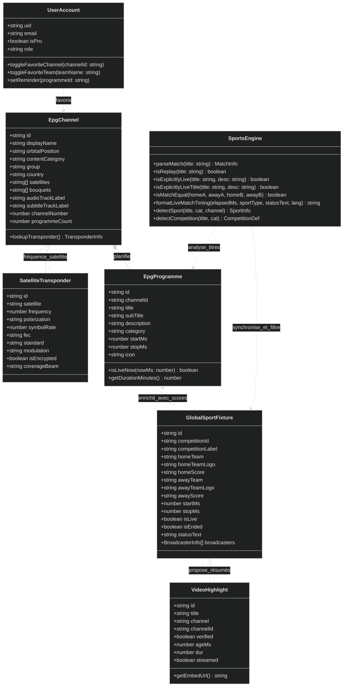
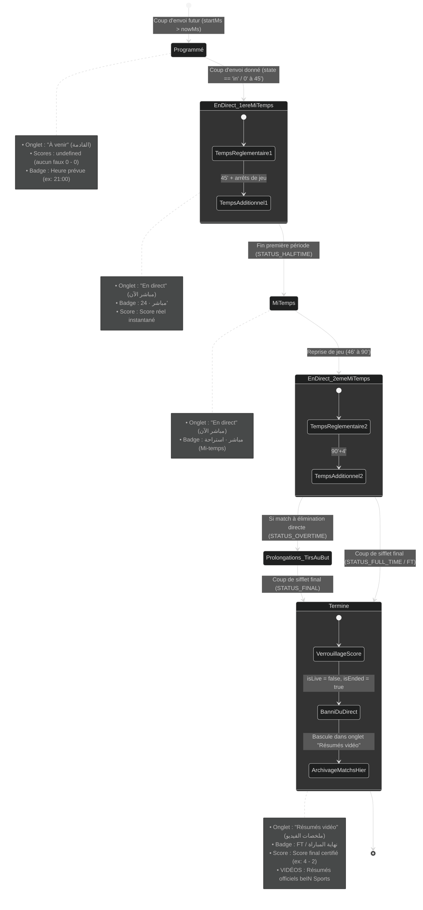
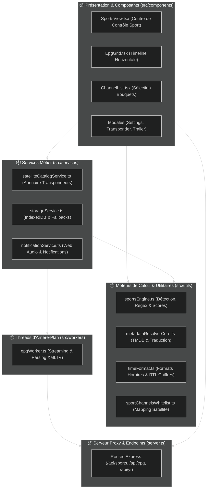

# PulseEPG — Dossier de Conception Détaillée & Diagrammes UML

**Projet** : PulseEPG (دليلك الشامل للقنوات)  
**Version** : 2.4.0  
**Statut** : Document de Conception Validé  

---

## 1. Diagramme de Classes UML (Domain Class Diagram)

Ce diagramme modélise les entités maîtresses du système, leurs attributs, leurs méthodes et leurs relations d'agrégation et de dépendance.

---

## 2. Machine à États Finis UML (Statechart) — Cycle de Vie d'un Match

Ce diagramme d'états modélise la transition rigoureuse entre les différentes phases d'un match de sport, garantissant qu'aucun match terminé ne puisse régresser ou être maintenu en direct.

---

## 3. Diagramme de Paquetages Applicatifs (Package Diagram)

Modélise l'organisation modulaire du code source et les frontières architecturales.

